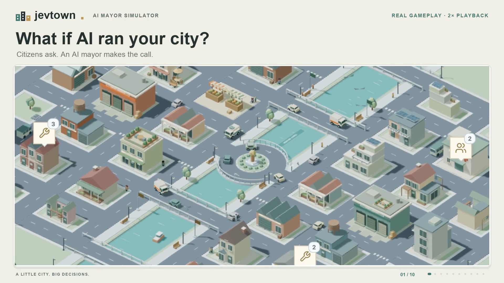
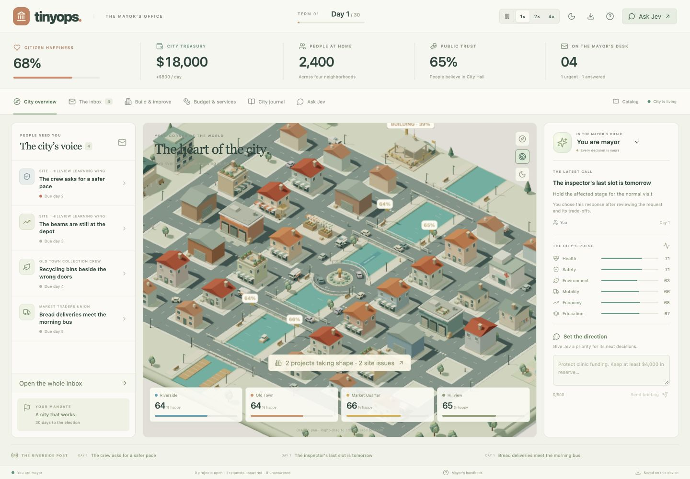
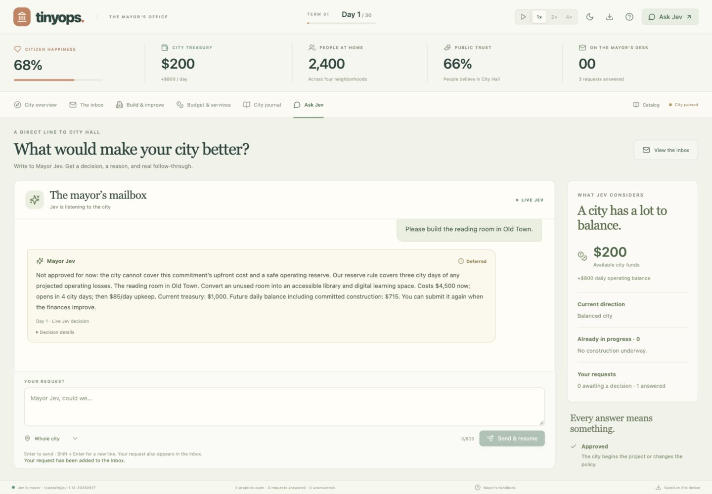
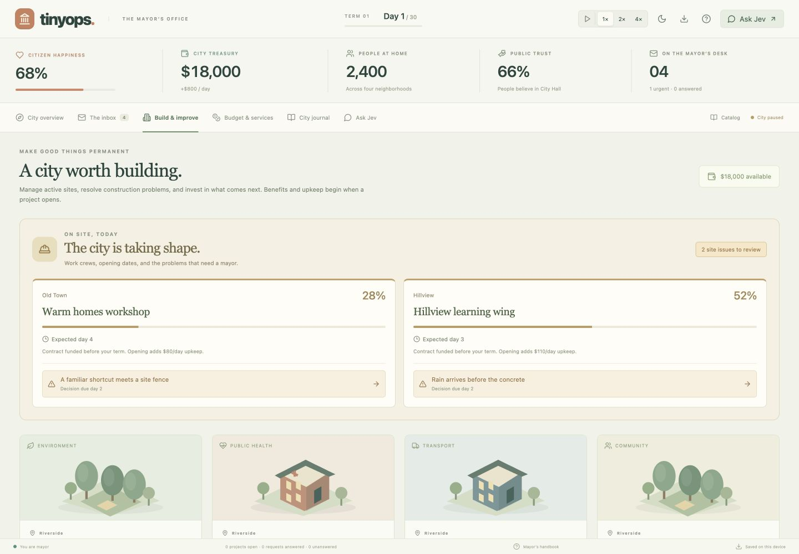
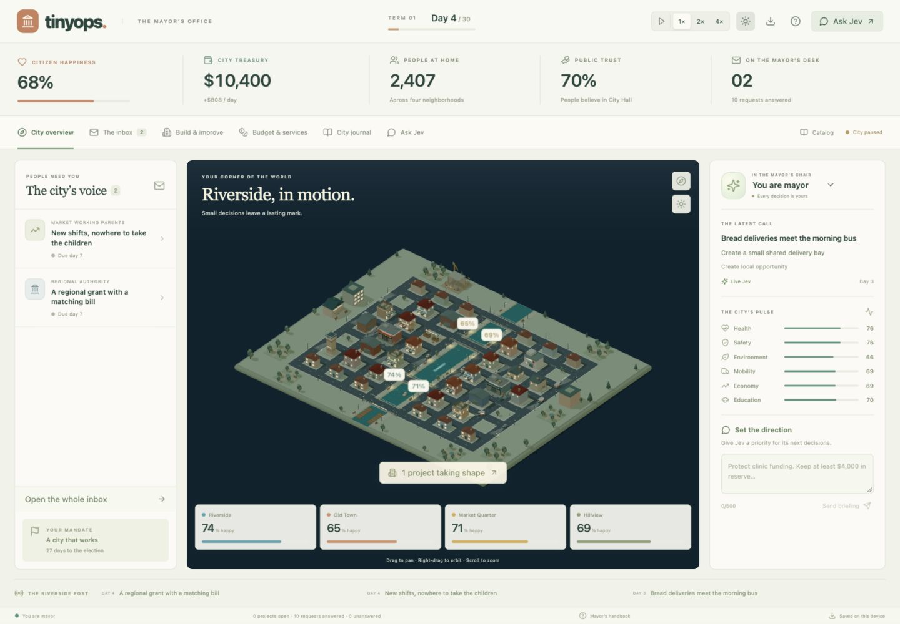

# Jevtown

**What if an AI ran your city?**

Jevtown is a tiny mayor simulator set in a hand-built 3D miniature city. Citizens write in with problems, construction sites run into trouble, the budget never quite adds up, and an election is always 30 days away. You can take the mayor's chair yourself, or hand the keys to **Jev**, an AI mayor that reads the city's mail and makes the call.



## What's in the city

- **Four neighborhoods.** Riverside, Old Town, Market Quarter, and Hillview each have their own population, mood, and architecture.
- **116 handwritten citizen stories.** Letters from residents, businesses, and authorities, each with real trade-offs, deadlines, and consequences. Ignore one and its consequences still land.
- **An AI mayor that has to follow the rules.** Jev picks from the same legal actions you can. The engine checks every decision against the budget, existing commitments, and what the city can actually do. Jev can't invent projects, promise impossible things, or quietly edit the numbers.
- **Ask Jev anything.** Write a request ("Could we build the reading room in Old Town?") and get back **Approved**, **Deferred**, or **Not approved**, with a reason and a real effect on the city.
- **Construction drama.** Sixteen civic projects, plus a dozen things that go wrong on site: rain during a concrete pour, late beams, an unmarked utility line. Each needs a decision.
- **A living city.** Service capacity, eight recurring residents with memories, aging bridges and power lines, shared work crews, weather, council votes, and promises you'll be held to.
- **A miniature that moves.** 24 vehicles on continuous routes, a roundabout on a bridge plaza, construction cranes, and an evening mode with warm windows, headlights, and fireflies.
- **Save and share.** The city autosaves in your browser. You can also download a city file and import it later.

| | |
| --- | --- |
|  |  |
|  |  |

## Quick start

You'll need [Node.js](https://nodejs.org/) 20.19+ or 22.12+.

```sh
git clone https://github.com/IjunaidI/TinyOps.git
cd TinyOps
npm install
npm run dev
```

Then open <http://127.0.0.1:5173>.

Choose a mandate (balanced, people, green, or growth), then pick how the city is run:

| Mode | What happens | Needs a key? |
| --- | --- | --- |
| **I'll be mayor** | You make every decision. | No |
| **Try the local advisor** | A rules-based Civic Advisor runs the city, with no network calls. | No |
| **Let Jev run the city** | Jev, an AI model reached through [OpenRouter](https://openrouter.ai/), governs live. | Yes, bring your own OpenRouter key |

A term is 30 city days, about ten minutes at 1× speed. <kbd>Space</kbd> pauses. Drag to pan, right-drag to orbit, and scroll to zoom.

> **About your API key:** Jevtown has no backend. Requests go straight from your browser to OpenRouter. The key stays in page memory only. It is never written to storage, URLs, logs, or save files, and it's cleared when you refresh.

## Scripts

| Command | What it does |
| --- | --- |
| `npm run dev` | Start the Vite dev server |
| `npm test` | Run the simulation, advisor, and traffic test suite |
| `npm run build` | Type-check and build a static site into `dist/` |
| `npm run preview` | Serve the production build locally |

The build is a plain static site, so you can host `dist/` anywhere (GitHub Pages, Netlify, and so on).

## How it's built

React 19, TypeScript, and Vite, with the city rendered in [Three.js](https://threejs.org/) through [React Three Fiber](https://r3f.docs.pmnd.rs/). There are no model or texture downloads: every building, car, tree, and crane is generated in code.

```
src/
  mayor/   game engine, story catalog, living-city sim, UI, and the 3D city
  world/   shared procedural models, materials, lighting, geometry batching
  ai/      Jev's OpenRouter transport, queueing, and response parsing
tests/     engine, advisor, and traffic scenario tests
docs/      handbook, design notes, and screenshots
```

Good places to start reading:

- [`src/mayor/engine.ts`](src/mayor/engine.ts): the city's economy, elections, and the authoritative state
- [`src/mayor/catalog.ts`](src/mayor/catalog.ts): all 116 citizen stories
- [`src/mayor/controller.ts`](src/mayor/controller.ts): how Jev and the local advisor decide what to do
- [`src/mayor/livingCity.ts`](src/mayor/livingCity.ts): services, residents, infrastructure, and the council

## Learn more

- [Handbook](docs/HANDBOOK.md): every system in detail, from budgets and elections to how Jev governs
- [Living City spec](docs/LIVING_CITY_SPEC.md): the design of the connected simulation
- [Neighborhood character](docs/NEIGHBORHOOD_CHARACTER.md): architecture, residents, and reactions
- [Map workspace](docs/MAP_WORKSPACE.md): the persistent map, alerts, and inspector
- [Recording guide](docs/SHOWCASE.md): how to capture gameplay footage
- [Validation log](docs/VALIDATION.md): what's been tested, release by release

## Contributing

This is a just-for-fun project, and contributions are welcome. New citizen stories, buildings, bug fixes, and balance tweaks are all fair game. Open an issue or a pull request, and run `npm test && npm run build` before you submit.

## Credits and license

All 3D models, pixel sprites, and city writing are original to this project. See [ASSET_CREDITS.md](ASSET_CREDITS.md) for details. Icons come from [Lucide](https://lucide.dev/) (ISC). The archived fonts in `public/fonts/` are under the SIL Open Font License.

The code is released under the [MIT License](LICENSE).
